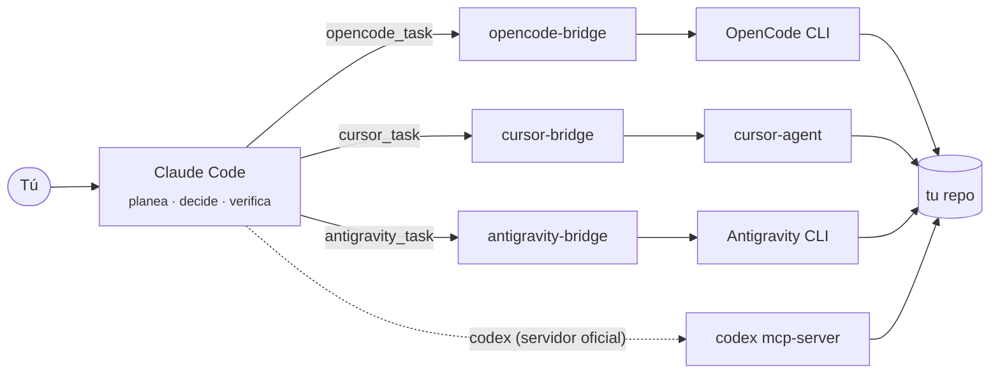

<div align="center">

# mcp-agent-bridges

**Claude Code planea y revisa; OpenCode, Cursor y Antigravity escriben el código.**

Tres servidores MCP sin dependencias que ponen las CLI de otros agentes de código detrás de una misma interfaz. Así un agente orquestador puede delegar trabajo, cambiar de modelo en cada llamada y verificar lo que recibe.

[](https://github.com/ddzendreros/mcp-agent-bridges/actions/workflows/ci.yml)
[](LICENSE)


[Inicio rápido](#inicio-rápido) · [Resultados](#benchmark) · [Interfaz](#una-interfaz-para-todos) · [Configuración](docs/configuration.md) · [Limitaciones](#limitaciones) · [English](README.md)

</div>

---

## El problema

Claude Code es muy bueno entendiendo un proyecto, decidiendo qué hacer y revisando el resultado. Gastar su contexto y sus tokens en escribir código repetitivo, refactors o archivos de tests es un desperdicio, sobre todo si ya tienes acceso (de pago o gratis) a otros agentes de código.

Todos esos agentes tienen una CLI sin interfaz, pero cada una usa sus propios parámetros, su propio formato de salida y su propio sistema de permisos, y algunas fallan en Windows cuando las lanza otro programa. **mcp-agent-bridges** envuelve cada CLI en un servidor MCP pequeño para que el orquestador vea siempre las mismas herramientas y el mismo informe.



## Lo principal

- **Una sola interfaz**: `prompt`, `cwd`, `model`, `fallback_models`, `session_id` y `timeout_s` en los tres, y el mismo informe de vuelta.
- **Modelo por llamada**: cambias de modelo sin tocar la configuración de cada herramienta.
- **Informe corto, registro completo**: el orquestador recibe un resumen (con ✓/✗ por cada comando que corrió el agente) y el detalle queda en un archivo local que puedes desactivar.
- **Seguro por defecto**: Antigravity trabaja en `accept-edits` y solo ejecuta los comandos que autorizas **de forma exacta**, solo para esa tarea.
- **Funciona en Windows**: resuelve los problemas que encontramos: prompts de varias líneas cortados por `cmd.exe`, `cursor-agent` sin poder ejecutar comandos (*"Can't find Bash"*) y OpenCode resolviendo rutas en otra carpeta.
- **Sin dependencias**: cada puente es un solo `server.mjs`.

## Inicio rápido

**1.** Instala e inicia sesión en las CLI que vayas a usar: [OpenCode](https://opencode.ai), [Cursor CLI](https://cursor.com/cli), Antigravity CLI. Necesitas Node.js 18 o superior.

**2.** Registra los puentes en Claude Code:

```bash
claude mcp add opencode    --scope user -- npx -y github:ddzendreros/mcp-agent-bridges opencode
claude mcp add cursor      --scope user -- npx -y github:ddzendreros/mcp-agent-bridges cursor
claude mcp add antigravity --scope user -- npx -y github:ddzendreros/mcp-agent-bridges antigravity
```

**3.** Reinicia Claude Code y pídele que delegue:

> *Usa opencode_task con el modelo opencode/deepseek-v4.1-flash-free para añadir tests a `src/parser.ts`, ejecútalos y luego revisa el diff.*

¿Prefieres clonar el repo o usas otro cliente MCP? En [docs/configuration.md](docs/configuration.md) están la configuración con `node`, un [ejemplo de `.claude.json`](examples/claude.json.example) y todas las variables de entorno.

**Codex** no es parte de este repo: es el servidor MCP oficial de OpenAI. Para añadirlo: `claude mcp add codex --scope user -- codex mcp-server`, y pásale `model` en cada llamada (el servidor ignora `-c model=...`).

## Benchmark

Misma tarea, mismo prompt, dos modelos por herramienta, revisado con un **verificador oculto** que los agentes no veían: arreglar 9 bugs según una especificación, implementar una función, escribir y correr al menos 6 tests y no tocar dos archivos protegidos. El proyecto sin arreglar saca 8/23.

| Herramienta | Modelo | Tiempo | ¿Corrió sus tests? | Verificador |
|---|---|---:|:---:|:---:|
| Codex¹ | gpt-5.6-sol | n/d | ✓ | **23/23** |
| Codex¹ | gpt-5.6-luna | n/d | ✓ | **23/23** |
| OpenCode | deepseek-v4.1-flash-free | 84 s | ✓ | **23/23** |
| OpenCode | nemotron-3.5-lightning-free | 151 s | ✓ | **23/23** |
| Cursor | auto | **34 s** | ✓ | **23/23** |
| Cursor | grok-4.7-medium | 77 s | ✓ | **23/23** |
| Antigravity | gemini-3.8-flash-medium | 511 s | ✓² | **23/23** |
| Antigravity | gemini-3.8-flash-low | 167 s | ✓² | **23/23** |

<sub>¹ `codex mcp-server` oficial, que no informa tiempos. ² Con el comando de tests en `allow_commands`. Una ejecución por configuración en una laptop con Windows, 2026-11-14: los tiempos son orientativos. Puedes repetirlo con [`benchmark/`](benchmark/).</sub>

| Herramienta | Para | Por qué |
|---|---|---|
| Codex | cambios importantes | los mejores modelos, informe corto y honesto, conserva la conversación |
| OpenCode | volumen y trabajo mecánico | $0 con modelos gratuitos, el informe más completo, cambio automático de modelo |
| Cursor | tareas rápidas | el más rápido de la prueba con `auto` |
| Antigravity | respaldo | correcto pero lento y con límites de uso |

## Una interfaz para todos

| | `opencode_task` | `cursor_task` | `antigravity_task` |
|---|:---:|:---:|:---:|
| `prompt`, `cwd`, `model`, `timeout_s` | ✓ | ✓ | ✓ |
| `session_id` (continuar) | ✓ | ✓ | ✓ |
| `fallback_models` | si falla | si el modelo no está disponible | si hay límite de uso o sin capacidad |
| solo lectura | `agent: "plan"` | `mode: "plan"` / `"ask"` | `mode: "plan"` |
| `allow_commands`, `max_recoveries` | — | — | ✓ |
| listar modelos | — | `cursor_models` | `antigravity_models` |

Referencia completa (en inglés): [docs/interface.md](docs/interface.md).

## Skill para Claude Code

[`skills/delegate-coding-tasks`](skills/delegate-coding-tasks/SKILL.md) es una skill opcional que le enseña al orquestador qué delegar, qué puente elegir, cómo escribir la tarea y cómo verificar el resultado. Copia la carpeta en `~/.claude/skills/`.

## Limitaciones

- **Antigravity es lento y depende de la cuota.** Fue el más lento en todas las pruebas (hasta ~8,5 min en una tarea pequeña) y sus modelos tienen límites de uso por cuenta. Si se alcanza el límite (o el servidor responde que no tiene capacidad), el puente lo informa; solo cambia a otros modelos de la misma cuenta si configuras `fallback_models`.
- **Antigravity no ejecuta comandos por defecto.** Solo los que pases exactos en `allow_commands` (sin comodines).
- **Cursor en el plan Free** muestra muchos modelos, pero solo funcionan `auto` y los Grok. Si pides otro, el puente usa `auto` y lo indica en el informe.
- **El informe es un resumen** construido a partir de la salida de cada CLI, que puede cambiar entre versiones. Revisa siempre el diff y corre los tests.
- **Sin paralelismo real**: Claude Code suele ejecutar una tras otra las llamadas a distintos servidores MCP.
- **Probado sobre todo en Windows**: la CI corre en Linux, macOS y Windows, pero las pruebas con las CLI reales se hicieron en Windows 11.

Este proyecto no incluye, ni aceptará, nada para rotar cuentas o saltarse los límites o los términos de uso de un proveedor.

## Proyectos parecidos

Hay otros servidores MCP para estas herramientas, por ejemplo [claude-opencode-mcp](https://github.com/putuandy/claude-opencode-mcp), [opencode-mcp](https://github.com/AlaeddineMessadi/opencode-mcp), [cursor-agent-mcp](https://github.com/sailay1996/cursor-agent-mcp), [cursormcp](https://github.com/sitien173/cursormcp), [gemini-mcp-tool](https://github.com/jamubc/gemini-mcp-tool), [Claude-Code-Antigravity-CLI-MCP-Server](https://github.com/SinanTufekci/Claude-Code-Antigravity-CLI-MCP-Server) y [all-agents-mcp](https://github.com/dokkabei97/all-agents-mcp). Lo que aporta este repo: los **mismos parámetros e informe** en tres CLI distintas, **modelo por llamada con respaldo**, **lista exacta de comandos permitidos** para Antigravity y un **benchmark reproducible** con verificador oculto.

## Licencia

[MIT](LICENSE) © Diego Zendreros. OpenCode, Cursor, Antigravity, Codex y Claude son marcas de sus respectivos dueños; este proyecto no está afiliado a ninguno de ellos.
