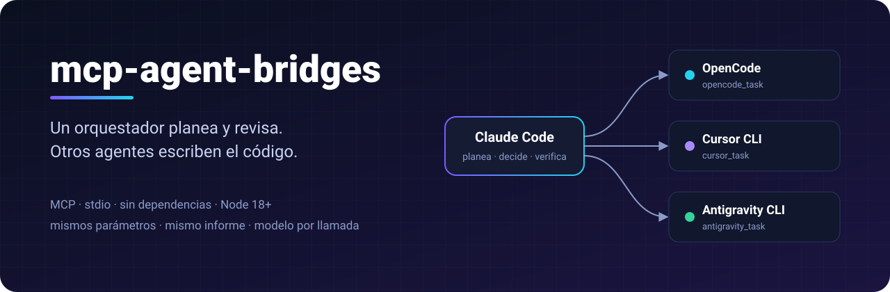
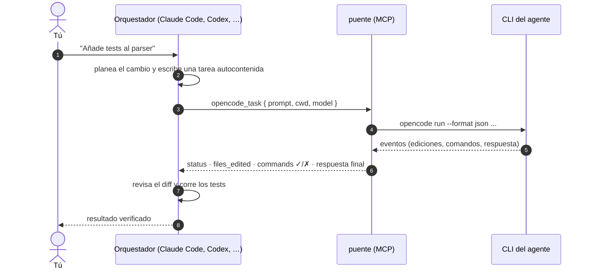
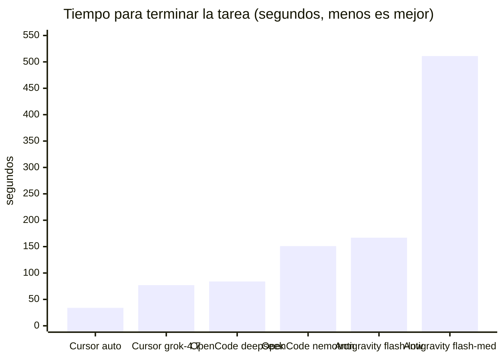

<p align="center">
  
</p>

<p align="center">
  <a href="README.md">🇬🇧 English</a> &nbsp;|&nbsp; <b>🇪🇸 Español</b>
</p>

<p align="center">
  <a href="https://github.com/ddzendreros/mcp-agent-bridges/actions/workflows/ci.yml"></a>
  <a href="LICENSE"></a>
  
  
  
  
</p>

<p align="center">
  <b><a href="#-inicio-rápido">Inicio rápido</a></b> ·
  <b><a href="#%EF%B8%8F-elige-tu-orquestador">Orquestadores</a></b> ·
  <b><a href="#-benchmark">Benchmark</a></b> ·
  <b><a href="#-una-interfaz">Interfaz</a></b> ·
  <b><a href="docs/configuration.md">Configuración</a></b> ·
  <b><a href="#%EF%B8%8F-limitaciones">Limitaciones</a></b>
</p>

---

**mcp-agent-bridges** son cinco servidores MCP pequeños para pasar trabajo de código entre **Claude Code**, **Codex**, **OpenCode**, **Cursor CLI** y **Antigravity CLI**. Cualquiera puede orquestar; los demás ejecutan y devuelven un informe corto y uniforme para que lo verifique.

El orquestador se queda con lo caro: entender el proyecto, decidir y revisar. Los delegados hacen lo mecánico (el código, los tests, el código repetitivo), muchas veces con modelos más baratos o gratuitos.

## ✨ Por qué

<table>
<tr>
<td width="33%" valign="top">

### 🔌 Una sola interfaz
`prompt`, `cwd`, `model`, `fallback_models`, `session_id` y `timeout_s` en todos los puentes, y el mismo informe de vuelta.

</td>
<td width="33%" valign="top">

### 🧾 Informes verificables
Archivos editados, cada comando con ✓ / ✗ y su código de salida, tokens y costo cuando existen. El detalle queda en un registro local que puedes apagar.

</td>
<td width="33%" valign="top">

### 🛡️ Permisos claros
Claude y Antigravity usan listas exactas de comandos permitidos; Codex solo ofrece escritura en el workspace o modo de lectura. OpenCode y Cursor aprueban solos por defecto (sin eso no pueden editar en modo no interactivo), así que usa control de versiones. Un timeout o una cancelación detienen al agente **y todo lo que haya lanzado**.

</td>
</tr>
<tr>
<td valign="top">

### 🔁 Modelo por llamada
Eliges el modelo en cada llamada y una lista ordenada de respaldo. Cada puente cambia solo bajo sus condiciones documentadas, nunca después de un timeout o una cancelación.

</td>
<td valign="top">

### 🪟 Funciona en Windows
Claude y Codex reciben el prompt por stdin, sin el límite de argv ni el problema de saltos de línea de `cmd.exe`. Se conservan los arreglos de Bash para Cursor y de directorio de trabajo para OpenCode.

</td>
<td valign="top">

### 📦 Sin dependencias
Cada puente es un solo `server.mjs`. Se usa con `npx` directo desde GitHub o con `node` desde un clon.

</td>
</tr>
</table>

## 🧭 Cómo funciona una delegación



## 🚀 Inicio rápido

Instala las CLI que quieras usar, inicia sesión en cada una y asegúrate de tener **Node.js 18+**. Previsualiza una configuración con Codex como orquestador y Antigravity y OpenCode como ejecutores:

```bash
npx -y github:ddzendreros/mcp-agent-bridges#v1.2.0 setup --orchestrator codex --executors antigravity,opencode
```

Todavía no se escribe nada. Revisa los comandos y archivos y vuelve a correr la misma línea con `--write`. La etiqueta `#v1.2.0` debe existir; se crea al publicar la versión. Reinicia el orquestador y delega:

> *Usa antigravity_task con el modelo gemini-3.8-flash-low para añadir tests a `src/parser.ts` y ejecutarlos. Después revisa tú el diff.*

Ejecuta `npx -y github:ddzendreros/mcp-agent-bridges#v1.2.0 doctor` para ver qué CLI están instaladas y sus versiones.

## 🎛️ Elige tu orquestador

El orquestador y los ejecutores se eligen por separado. Por ejemplo, alguien que solo paga Antigravity puede usar Codex para planear y revisar, y dejarle la implementación a Antigravity.

| Orquestador | Qué hace setup | Dónde escribe la guía |
|---|---|---|
| Claude Code | `claude mcp add --scope user` | `~/.claude/skills/delegate-coding-tasks/SKILL.md` |
| Codex | `codex mcp add`; configura `tool_timeout_sec = 1800` en la tabla de cada servidor de `$CODEX_HOME/config.toml` o `~/.codex/config.toml` | `$CODEX_HOME/AGENTS.md` o `~/.codex/AGENTS.md` |
| OpenCode | `opencode mcp add --global` | `$XDG_CONFIG_HOME/opencode/AGENTS.md` o `~/.config/opencode/AGENTS.md` |
| Cursor | combina los servidores con `~/.cursor/mcp.json` | no tiene archivo global; usa `--guide-file <proyecto>/AGENTS.md` |
| Antigravity | `agy mcp add` | `~/.gemini/GEMINI.md` |

La guía sale de [`templates/orchestrator-guide.md`](templates/orchestrator-guide.md) e incluye solo los ejecutores elegidos. En `AGENTS.md`, `GEMINI.md` o un archivo de guía personalizado, setup administra únicamente el bloque entre `<!-- mcp-agent-bridges:start -->` y `<!-- mcp-agent-bridges:end -->`. No sobrescribe una skill de Claude que no haya generado. Antes de cambiar un archivo existente crea una copia `.bak-<timestamp>`. El JSON de Cursor se combina para conservar otros servidores.

Los nombres de los servidores MCP son `claude`, `codex-bridge`, `opencode`, `cursor` y `antigravity`. Se usa `codex-bridge` para no chocar con el `codex mcp-server` oficial, que suele registrarse como `codex`.

Opciones de setup:

- `--executors all` elige todos menos el orquestador. Si una lista explícita incluye al orquestador, se omite con una nota.
- `--source npx|local` elige el comando del puente. Por defecto usa local dentro de un clon y `npx` fijado a la versión en los demás casos; en Windows registra `cmd /c npx`.
- `--no-guide` omite la guía; `--guide-file <ruta>` escribe su bloque administrado en el archivo que elijas.

Con Claude Code como orquestador, setup hace el equivalente de estos comandos por ejecutor:

```bash
claude mcp add opencode    --scope user -- npx -y github:ddzendreros/mcp-agent-bridges#v1.2.0 opencode
claude mcp add cursor      --scope user -- npx -y github:ddzendreros/mcp-agent-bridges#v1.2.0 cursor
claude mcp add antigravity --scope user -- npx -y github:ddzendreros/mcp-agent-bridges#v1.2.0 antigravity
claude mcp add codex-bridge --scope user -- npx -y github:ddzendreros/mcp-agent-bridges#v1.2.0 codex
```

<details>
<summary><b>Otras formas de instalarlo</b> (clon, configuración manual, otros clientes MCP)</summary>

```bash
git clone https://github.com/ddzendreros/mcp-agent-bridges.git
claude mcp add opencode --scope user -- node /ruta/a/mcp-agent-bridges/packages/opencode-bridge/server.mjs
```

O edita `~/.claude.json` a mano con [`examples/claude.json.example`](examples/claude.json.example). Cualquier cliente MCP que use stdio puede ejecutar los mismos comandos. Todos los detalles y variables de entorno están en [docs/configuration.md](docs/configuration.md).
</details>

<details>
<summary><b>Añadir Codex</b> (el puente de este repo o el servidor oficial de OpenAI)</summary>

Codex puede ejecutar mediante `codex-bridge`, que expone `codex_task` y devuelve el mismo informe de archivos, herramientas, comandos, tokens y respuesta final que los demás puentes:

```bash
claude mcp add codex-bridge --scope user -- npx -y github:ddzendreros/mcp-agent-bridges#v1.2.0 codex
```

El `codex mcp-server` oficial sigue siendo una opción separada y este repo no lo modifica:

```bash
claude mcp add codex --scope user -- codex mcp-server
```

Pásale `model` en cada llamada (el servidor ignora `-c model=...`) y usa `sandbox: "workspace-write"` con `approval-policy: "never"`.
</details>

## 📊 Benchmark

Misma tarea y mismo prompt para todos, dos modelos por herramienta, revisado con un **verificador oculto** de 23 comprobaciones que los agentes no veían: arreglar 9 bugs según una especificación, implementar una función, escribir y correr al menos 6 tests y no tocar dos archivos protegidos. El proyecto sin arreglar saca 8/23.

| Herramienta | Modelo | Tiempo | ¿Corrió sus tests? | Verificador |
|:--|:--|--:|:--:|:--:|
| Codex¹ | gpt-5.6-sol | n/d | ✅ | **23/23** |
| Codex¹ | gpt-5.6-luna | n/d | ✅ | **23/23** |
| OpenCode | deepseek-v4.1-flash-free | 84 s | ✅ | **23/23** |
| OpenCode | nemotron-3.5-lightning-free | 151 s | ✅ | **23/23** |
| Cursor | auto | **34 s** | ✅ | **23/23** |
| Cursor | grok-4.7-medium | 77 s | ✅ | **23/23** |
| Antigravity | gemini-3.8-flash-medium | 511 s | ✅² | **23/23** |
| Antigravity | gemini-3.8-flash-low | 167 s | ✅² | **23/23** |



<sub>¹ `codex mcp-server` oficial, que no informa tiempos. ² Con el comando de tests en `allow_commands`. Una ejecución por configuración en una laptop con Windows, 2026-11-14: los tiempos son orientativos. Detalles y la prueba de esta versión del código: [benchmark/RESULTS.md](benchmark/RESULTS.md).</sub>

### Qué muestra la prueba y qué no

Todas las configuraciones resolvieron la tarea, así que este benchmark **no ordena las herramientas por calidad**: la tarea es demasiado fácil para separarlas y una ejecución por configuración no da para estadística. Lo que sí muestra es velocidad, costo y cuánto ayuda cada informe a verificar el trabajo. Con eso y el uso diario:

| | Encaja en | Lo que se vio |
|:--|:--|:--|
| 💸 **OpenCode** | volumen y trabajo mecánico | $0 con modelos gratuitos, el informe más completo, cambio automático de modelo |
| ⚡ **Cursor** | tareas rápidas | el más rápido con `auto`; el plan Free agota su uso pronto |
| 🧯 **Antigravity** | respaldo | correcto pero lento y con límites de uso |
| **Codex** (servidor oficial en este benchmark) | seguimientos en la misma conversación | informes cortos, pero su salida MCP no trae tiempos, archivos ni comandos |

Para comparar calidad haría falta una tarea más difícil y varias ejecuciones por configuración; se aceptan contribuciones.

## 🔌 Una interfaz

| | `claude_task` | `codex_task` | `opencode_task` | `cursor_task` | `antigravity_task` |
|:--|:--:|:--:|:--:|:--:|:--:|
| `prompt` · `cwd` · `model` · `timeout_s` | ✅ | ✅ | ✅ | ✅ | ✅ |
| `session_id` · `fallback_models` | ✅ | ✅ | ✅ | ✅ | ✅ |
| condición de respaldo | uso / sobrecarga / modelo no disponible | uso / capacidad / modelo no disponible | error | modelo fuera del plan | uso / capacidad |
| solo lectura | `mode: "plan"` | `sandbox: "read-only"` | `agent: "plan"` | `mode: "plan"` / `"ask"` | `mode: "plan"` |
| control de comandos | `allow_commands` exactos | sandbox | `auto_approve` | `force` | `allow_commands` exactos |
| listar modelos | — | — | — | `cursor_models` | `antigravity_models` |

Claude usa `acceptEdits` por defecto; los comandos permitidos se convierten en entradas exactas `Bash(<cmd>)`, mientras los demás se niegan y se informan sin detener la tarea. `use_mcp` es falso por defecto. Codex usa `workspace-write` por defecto, siempre establece `approval_policy=never` y acepta `effort` de `minimal` a `xhigh`; no hay modo de acceso completo.

Cada llamada devuelve el mismo tipo de informe:

```text
status: ok (exit 0, 57s)
session_id: 3f2a9c1e-5b7d-4e8a-9c0f-1d2e3f4a5b6c
model: Auto
attempts: claude-opus-5-5-high: not available for this account → auto: ok
files_edited: /work/inventario.py, /work/tests/test_nuevo.py
tools: read×4, glob×1, edit×2, shell×1
commands:
  ✓ python -m unittest discover -s tests -t . (exit 0 → OK)
log: ~/.mcp-agent-bridges/logs/cursor/2026-11-14T16-43-47-988Z_3f2a9c1e.jsonl
--- final answer ---
Fixed normalization, validation and de-duplication, implemented reabastecer,
added 6 tests. python -m unittest discover -s tests -t . → 7 tests OK.
```

Es un resumen de los eventos de la CLI; revisa siempre el diff y corre los tests.

Referencia completa (en inglés): [docs/interface.md](docs/interface.md).

### Pruebas con las CLI reales

Comprobado el 2026-11-17 en Windows 11 con Claude 2.1.325, Codex CLI 0.167.2, Antigravity 1.5.x y OpenCode:

- `claude_task` creó un archivo, solo ejecutó el comando permitido y devolvió un informe `ok`; otro comando fue rechazado.
- `codex_task` completó una tarea nueva y un seguimiento con `session_id`.
- Codex delegó un arreglo y su test a `antigravity_task` con `gemini-3.8-flash-low`; Antigravity arregló el código, escribió y corrió el test, y Codex verificó el archivo. Fueron 55 segundos en total.
- `setup --write`, con Codex orquestando Antigravity y OpenCode sobre un `CODEX_HOME` temporal, registró ambos servidores según `codex mcp list`.
- Codex respetó `tool_timeout_sec`: un valor de 20 segundos cortó una llamada de 75. OpenCode completó una llamada MCP de 130 segundos como cliente. No se midieron aquí timeouts de varios minutos para Claude Code, Cursor ni Antigravity como clientes; Claude Code ya había completado tareas del benchmark de Antigravity de unos 8,5 minutos.

## ⚠️ Limitaciones

| | |
|:--|:--|
| 🐢 **Antigravity es lento y depende de la cuota** | Fue el más lento en todas las pruebas (hasta ~8,5 min en una tarea pequeña) y sus modelos tienen límites de uso por cuenta. Si se alcanza el límite, o el servidor responde que no tiene capacidad, el puente lo informa. Solo cambia a otros modelos de la misma cuenta si configuras `fallback_models`. |
| 🔒 **Antigravity no ejecuta comandos por defecto** | Solo los que pases exactos en `allow_commands` (sin comodines). |
| 🎟️ **Cursor en el plan Free** | Muestra muchos modelos, pero solo funcionan `auto` y los Grok. Si pides otro, usa `auto` y lo indica en el informe. |
| 🪟 **Cursor a través de `cmd.exe`** | En Windows el puente lanza directamente el `node.exe` de Cursor para que el prompt llegue intacto. Si no encuentra esa instalación (por ejemplo, `CURSOR_AGENT_BIN` apunta a un lanzador fuera de la carpeta de instalación), el prompt pasa por `cmd.exe`: los saltos de línea se cambian por espacios (el informe lo avisa) y se expanden los `%NOMBRE%`. |
| ✅ **Aprobaciones MCP de Codex** | Como orquestador, Codex pide aprobación para cada llamada MCP. `codex exec` no interactivo con `approval_policy=never` la rechaza a menos que la tabla del servidor tenga `default_tools_approval_mode = "approve"`. Setup no lo configura porque elimina una confirmación de permisos; tú decides si agregarlo. |
| 🪟 **Sandbox de Codex en Windows** | A veces el sandbox no puede iniciar PowerShell para un comando. Codex vuelve a intentarlo con cmd; el informe conserva el intento fallido como `✗ ... could not run` y añade una nota para revisar que la tarea esté completa. |
| 🔁 **La protección contra delegación anidada depende del entorno** | Un puente rechaza `tools/call` anidados a la profundidad configurada solo si el ejecutor pasa `MCP_AGENT_BRIDGES_DEPTH` a sus servidores MCP. Los prompts también indican que no se delegue y Claude no recibe servidores MCP salvo que uses `use_mcp: true`. |
| 🧾 **El informe es un resumen** | Se construye a partir de la salida de cada CLI, que puede cambiar entre versiones. Revisa siempre el diff y corre los tests. |
| ⏱️ **Sin paralelismo real** | Claude Code suele ejecutar una tras otra las llamadas a distintos servidores MCP. |
| 🪟 **Probado sobre todo en Windows** | La CI corre en Linux, macOS y Windows, pero las pruebas con las CLI reales se hicieron en Windows 11. |

> [!IMPORTANT]
> Este proyecto no incluye, ni aceptará, nada para rotar cuentas o saltarse los límites o los términos de uso de un proveedor.

## 🔍 Proyectos parecidos

Hay otros servidores MCP para estas herramientas: [claude-opencode-mcp](https://github.com/putuandy/claude-opencode-mcp), [opencode-mcp](https://github.com/AlaeddineMessadi/opencode-mcp), [cursor-agent-mcp](https://github.com/sailay1996/cursor-agent-mcp), [cursormcp](https://github.com/sitien173/cursormcp), [gemini-mcp-tool](https://github.com/jamubc/gemini-mcp-tool), [Claude-Code-Antigravity-CLI-MCP-Server](https://github.com/SinanTufekci/Claude-Code-Antigravity-CLI-MCP-Server) y [all-agents-mcp](https://github.com/dokkabei97/all-agents-mcp).

Lo que aporta este repo: los **mismos parámetros e informe** en cinco CLI distintas, **modelo por llamada con respaldo**, **lista exacta de comandos permitidos** para Claude y Antigravity y un **benchmark reproducible** con verificador oculto.

## 🗂️ Estructura del repositorio

```text
packages/
├── claude-bridge/server.mjs        servidor MCP para Claude Code
├── codex-bridge/server.mjs         servidor MCP para Codex CLI
├── opencode-bridge/server.mjs      servidor MCP para OpenCode
├── cursor-bridge/server.mjs        servidor MCP para Cursor CLI
└── antigravity-bridge/server.mjs   servidor MCP para Antigravity CLI
bin/cli.mjs                         entrada para puentes, setup y doctor
bin/setup.mjs                       plan, cambios de archivos y revisión de CLI
templates/orchestrator-guide.md     guía para los ejecutores elegidos
benchmark/                          tarea, verificador oculto, prompt y resultados
docs/                               referencia de configuración e interfaz
examples/claude.json.example        configuración MCP manual para Claude Code
test/                               pruebas y fixtures sin CLI reales
```

## 🛠️ Desarrollo

```bash
npm test
```

No hace falta tener instalada ninguna CLI real. Las pruebas cubren el protocolo MCP, los esquemas y errores de cada puente; los parsers de eventos con fixtures; procesos, cancelación y stdin; el plan y los cambios de setup; y el código compartido.

Cada puente es un archivo autocontenido a propósito. El código de procesos y MCP entre los marcadores `// <shared>` debe ser idéntico en los cinco; `test/shared.test.mjs` lo comprueba.

Se aceptan issues y pull requests; consulta [CONTRIBUTING.md](CONTRIBUTING.md). Los problemas de seguridad se reportan en privado como indica [SECURITY.md](SECURITY.md).

## 📄 Licencia

[MIT](LICENSE) © Diego Zendreros

<sub>OpenCode, Cursor, Antigravity, Codex y Claude son marcas de sus respectivos dueños. Este proyecto no está afiliado a ninguno de ellos.</sub>
