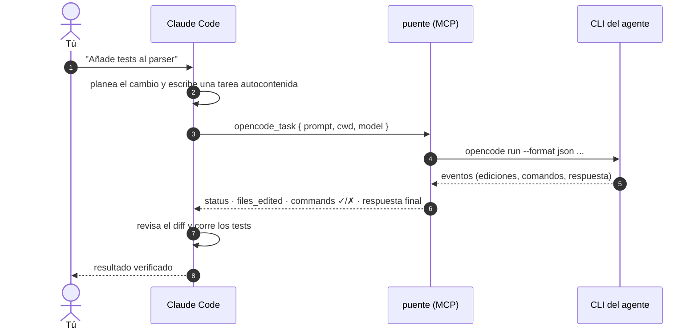
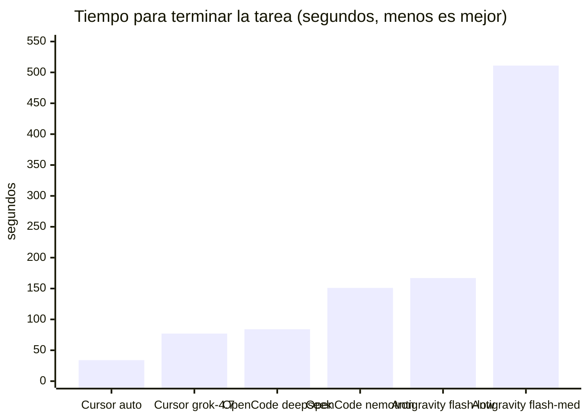

<p align="center">
  
</p>

<p align="center">
  <a href="README.md">🇬🇧 English</a> &nbsp;|&nbsp; <b>🇪🇸 Español</b>
</p>

<p align="center">
  <a href="https://github.com/ddzendreros/mcp-agent-bridges/actions/workflows/ci.yml"></a>
  <a href="LICENSE"></a>
  
  
  
</p>

<p align="center">
  <b><a href="#-inicio-rápido">Inicio rápido</a></b> ·
  <b><a href="#-benchmark">Benchmark</a></b> ·
  <b><a href="#-una-interfaz">Interfaz</a></b> ·
  <b><a href="docs/configuration.md">Configuración</a></b> ·
  <b><a href="#%EF%B8%8F-limitaciones">Limitaciones</a></b>
</p>

---

**mcp-agent-bridges** son tres servidores MCP pequeños que permiten que **Claude Code** (o cualquier cliente MCP) le pase trabajo de código a **OpenCode**, **Cursor CLI** y **Antigravity CLI**, y reciba de vuelta un informe corto y uniforme que puede verificar.

El orquestador se queda con lo caro: entender el proyecto, decidir y revisar. Los delegados hacen lo mecánico (el código, los tests, el código repetitivo), muchas veces con modelos más baratos o gratuitos.

## ✨ Por qué

<table>
<tr>
<td width="33%" valign="top">

### 🔌 Una sola interfaz
`prompt`, `cwd`, `model`, `fallback_models`, `session_id` y `timeout_s` en los tres puentes, y el mismo informe de vuelta.

</td>
<td width="33%" valign="top">

### 🧾 Informes verificables
Archivos editados, cada comando con ✓ / ✗ y su código de salida, tokens y costo cuando existen. El detalle queda en un registro local que puedes apagar.

</td>
<td width="33%" valign="top">

### 🛡️ Seguro por defecto
Antigravity trabaja en `accept-edits` y solo ejecuta los comandos que autorizas **de forma exacta**, solo para esa tarea.

</td>
</tr>
<tr>
<td valign="top">

### 🔁 Modelo por llamada
Eliges el modelo en cada llamada y una lista de respaldo: si falla (OpenCode), si el modelo no está en tu plan (Cursor) o si hay límite de uso o falta capacidad (Antigravity).

</td>
<td valign="top">

### 🪟 Funciona en Windows
Resuelve problemas reales: prompts de varias líneas cortados por `cmd.exe`, `cursor-agent` sin poder ejecutar comandos (*"Can't find Bash"*) y OpenCode resolviendo rutas en otra carpeta.

</td>
<td valign="top">

### 📦 Sin dependencias
Cada puente es un solo `server.mjs`. Se usa con `npx` directo desde GitHub o con `node` desde un clon.

</td>
</tr>
</table>

## 🧭 Cómo funciona una delegación



## 🚀 Inicio rápido

**1. Instala los agentes que quieras usar** e inicia sesión en cada uno: [OpenCode](https://opencode.ai), [Cursor CLI](https://cursor.com/cli), Antigravity CLI. También necesitas **Node.js 18+**.

**2. Registra los puentes** en Claude Code:

```bash
claude mcp add opencode    --scope user -- npx -y github:ddzendreros/mcp-agent-bridges opencode
claude mcp add cursor      --scope user -- npx -y github:ddzendreros/mcp-agent-bridges cursor
claude mcp add antigravity --scope user -- npx -y github:ddzendreros/mcp-agent-bridges antigravity
```

**3. Reinicia Claude Code y delega:**

> *Usa opencode_task con el modelo opencode/deepseek-v4.1-flash-free para añadir tests a `src/parser.ts` y ejecutarlos. Después revisa tú el diff.*

<details>
<summary><b>Otras formas de instalarlo</b> (clon, configuración manual, otros clientes MCP)</summary>

```bash
git clone https://github.com/ddzendreros/mcp-agent-bridges.git
claude mcp add opencode --scope user -- node /ruta/a/mcp-agent-bridges/packages/opencode-bridge/server.mjs
```

O edita `~/.claude.json` a mano con [`examples/claude.json.example`](examples/claude.json.example). Todas las variables de entorno están en [docs/configuration.md](docs/configuration.md).
</details>

<details>
<summary><b>Añadir Codex</b> (servidor oficial de OpenAI, no es parte de este repo)</summary>

Codex ya trae su propio servidor MCP. Este repo no lo envuelve ni lo modifica; solo aparece en el benchmark como referencia.

```bash
claude mcp add codex --scope user -- codex mcp-server
```

Pásale `model` en cada llamada (el servidor ignora `-c model=...`) y usa `sandbox: "workspace-write"` con `approval-policy: "never"`.
</details>

## 📊 Benchmark

Misma tarea y mismo prompt para todos, dos modelos por herramienta, revisado con un **verificador oculto** de 23 comprobaciones que los agentes no veían: arreglar 9 bugs según una especificación, implementar una función, escribir y correr al menos 6 tests y no tocar dos archivos protegidos. El proyecto sin arreglar saca 8/23.

| Herramienta | Modelo | Tiempo | ¿Corrió sus tests? | Verificador |
|:--|:--|--:|:--:|:--:|
| Codex¹ | gpt-5.6-sol | n/d | ✅ | **23/23** |
| Codex¹ | gpt-5.6-luna | n/d | ✅ | **23/23** |
| OpenCode | deepseek-v4.1-flash-free | 84 s | ✅ | **23/23** |
| OpenCode | nemotron-3.5-lightning-free | 151 s | ✅ | **23/23** |
| Cursor | auto | **34 s** | ✅ | **23/23** |
| Cursor | grok-4.7-medium | 77 s | ✅ | **23/23** |
| Antigravity | gemini-3.8-flash-medium | 511 s | ✅² | **23/23** |
| Antigravity | gemini-3.8-flash-low | 167 s | ✅² | **23/23** |



<sub>¹ `codex mcp-server` oficial, que no informa tiempos. ² Con el comando de tests en `allow_commands`. Una ejecución por configuración en una laptop con Windows, 2026-11-14: los tiempos son orientativos. Detalles y la prueba de esta versión del código: [benchmark/RESULTS.md](benchmark/RESULTS.md).</sub>

### Cuál usar

| | Para | Por qué |
|:--|:--|:--|
| 🥇 **Codex** | cambios importantes o delicados | los mejores modelos, informe corto y honesto, conserva la conversación |
| 💸 **OpenCode** | volumen y trabajo mecánico | $0 con modelos gratuitos, el informe más completo, cambio automático de modelo |
| ⚡ **Cursor** | tareas rápidas | el más rápido de la prueba con `auto` |
| 🧯 **Antigravity** | respaldo | correcto pero lento y con límites de uso |

## 🔌 Una interfaz

| | `opencode_task` | `cursor_task` | `antigravity_task` |
|:--|:--:|:--:|:--:|
| `prompt` · `cwd` · `model` · `timeout_s` | ✅ | ✅ | ✅ |
| `session_id` (continuar) | ✅ | ✅ | ✅ |
| `fallback_models` se activa | si falla | si el modelo no está en tu plan | si hay límite de uso o sin capacidad |
| solo lectura | `agent: "plan"` | `mode: "plan"` / `"ask"` | `mode: "plan"` |
| `allow_commands` · `max_recoveries` | — | — | ✅ |
| listar modelos | — | `cursor_models` | `antigravity_models` |

Referencia completa (en inglés): [docs/interface.md](docs/interface.md).

## ⚠️ Limitaciones

| | |
|:--|:--|
| 🐢 **Antigravity es lento y depende de la cuota** | Fue el más lento en todas las pruebas (hasta ~8,5 min en una tarea pequeña) y sus modelos tienen límites de uso por cuenta. Si se alcanza el límite, o el servidor responde que no tiene capacidad, el puente lo informa. Solo cambia a otros modelos de la misma cuenta si configuras `fallback_models`. |
| 🔒 **Antigravity no ejecuta comandos por defecto** | Solo los que pases exactos en `allow_commands` (sin comodines). |
| 🎟️ **Cursor en el plan Free** | Muestra muchos modelos, pero solo funcionan `auto` y los Grok. Si pides otro, usa `auto` y lo indica en el informe. |
| 🧾 **El informe es un resumen** | Se construye a partir de la salida de cada CLI, que puede cambiar entre versiones. Revisa siempre el diff y corre los tests. |
| ⏱️ **Sin paralelismo real** | Claude Code suele ejecutar una tras otra las llamadas a distintos servidores MCP. |
| 🪟 **Probado sobre todo en Windows** | La CI corre en Linux, macOS y Windows, pero las pruebas con las CLI reales se hicieron en Windows 11. |

> [!IMPORTANT]
> Este proyecto no incluye, ni aceptará, nada para rotar cuentas o saltarse los límites o los términos de uso de un proveedor.

## 🔍 Proyectos parecidos

Hay otros servidores MCP para estas herramientas: [claude-opencode-mcp](https://github.com/putuandy/claude-opencode-mcp), [opencode-mcp](https://github.com/AlaeddineMessadi/opencode-mcp), [cursor-agent-mcp](https://github.com/sailay1996/cursor-agent-mcp), [cursormcp](https://github.com/sitien173/cursormcp), [gemini-mcp-tool](https://github.com/jamubc/gemini-mcp-tool), [Claude-Code-Antigravity-CLI-MCP-Server](https://github.com/SinanTufekci/Claude-Code-Antigravity-CLI-MCP-Server) y [all-agents-mcp](https://github.com/dokkabei97/all-agents-mcp).

Lo que aporta este repo: los **mismos parámetros e informe** en tres CLI distintas, **modelo por llamada con respaldo**, **lista exacta de comandos permitidos** para Antigravity y un **benchmark reproducible** con verificador oculto.

## 📄 Licencia

[MIT](LICENSE) © Diego Zendreros

<sub>OpenCode, Cursor, Antigravity, Codex y Claude son marcas de sus respectivos dueños. Este proyecto no está afiliado a ninguno de ellos.</sub>
