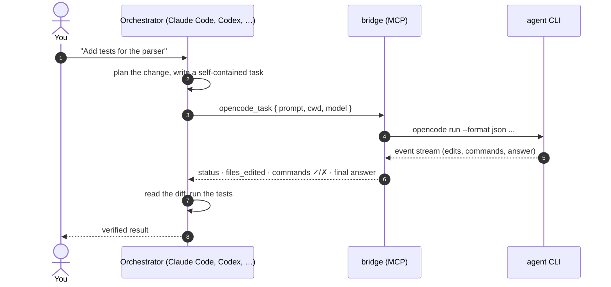
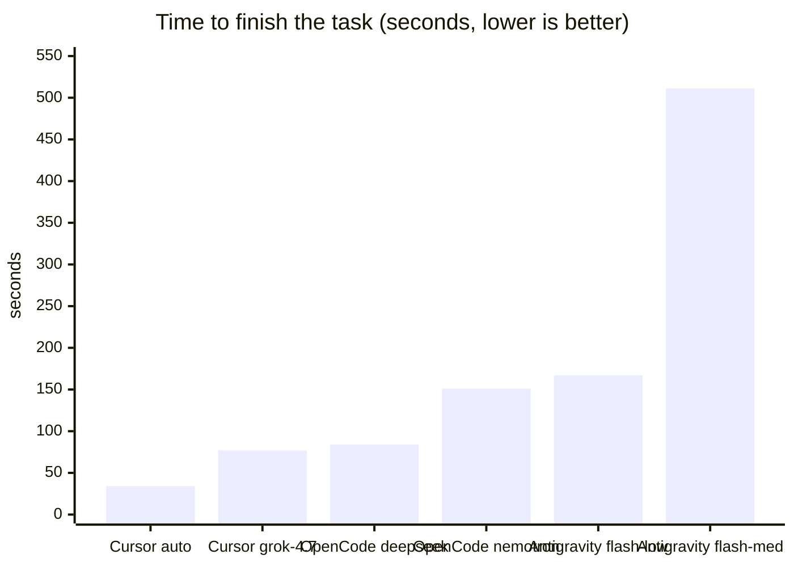

<p align="center">
  
</p>

<p align="center">
  <b>🇬🇧 English</b> &nbsp;|&nbsp; <a href="README.es.md">🇪🇸 Español</a>
</p>

<p align="center">
  <a href="https://github.com/ddzendreros/mcp-agent-bridges/actions/workflows/ci.yml"></a>
  <a href="LICENSE"></a>
  
  
  
  
</p>

<p align="center">
  <b><a href="#-quick-start">Quick start</a></b> ·
  <b><a href="#%EF%B8%8F-pick-your-orchestrator">Orchestrators</a></b> ·
  <b><a href="#-benchmark">Benchmark</a></b> ·
  <b><a href="#-one-interface">Interface</a></b> ·
  <b><a href="docs/configuration.md">Configuration</a></b> ·
  <b><a href="#%EF%B8%8F-limitations">Limitations</a></b>
</p>

---

**mcp-agent-bridges** is a set of five small MCP servers for handing coding work among **Claude Code**, **Codex**, **OpenCode**, **Cursor CLI** and **Antigravity CLI**. Any one can orchestrate; the others execute and return a short, uniform report for it to verify.

The orchestrator keeps the expensive part: understanding the codebase, deciding and reviewing. The delegates do the mechanical part (the code, the tests, the boilerplate), often with cheaper or free models.

## ✨ Why

<table>
<tr>
<td width="33%" valign="top">

### 🔌 One interface
`prompt`, `cwd`, `model`, `fallback_models`, `session_id` and `timeout_s` on every bridge, and the same report back. Switch executors without relearning flags.

</td>
<td width="33%" valign="top">

### 🧾 Reports you can check
Files edited, every command with ✓ / ✗ and its exit code, tokens and cost when available. The raw event stream goes to a local log you can turn off.

</td>
<td width="33%" valign="top">

### 🛡️ Clear permissions
Claude and Antigravity use exact command allow-lists; Codex offers only workspace-write or read-only. OpenCode and Cursor auto-approve by default (headless they cannot edit otherwise), so use version control. A timeout or cancellation stops the agent **and everything it started**.

</td>
</tr>
<tr>
<td valign="top">

### 🔁 Model per call
Choose the model on every call and give an ordered fallback list. Each bridge switches only on its documented error conditions, never after timeout or cancellation.

</td>
<td valign="top">

### 🪟 Works on Windows
Claude and Codex prompts go on stdin, avoiding the argv limit and `cmd.exe` line breaks. The existing Cursor Bash and OpenCode working-directory fixes remain.

</td>
<td valign="top">

### 📦 Zero dependencies
Each bridge is a single readable `server.mjs`. Run it with `npx` straight from GitHub, or with `node` from a clone.

</td>
</tr>
</table>

## 🧭 How a delegation works



## 🚀 Quick start

Install and log in to the agent CLIs you want, plus **Node.js 18+**. Preview a Codex-orchestrated setup with Antigravity and OpenCode as executors:

```bash
npx -y github:ddzendreros/mcp-agent-bridges#v1.2.0 setup --orchestrator codex --executors antigravity,opencode
```

Nothing is written yet. Review the commands and files, then rerun the same line with `--write`. The `#v1.2.0` tag must exist; it is created when the release is published. Restart the orchestrator and delegate:

> *Use antigravity_task with model gemini-3.8-flash-low to add tests for `src/parser.ts` and run them. Then review the diff yourself.*

Run `npx -y github:ddzendreros/mcp-agent-bridges#v1.2.0 doctor` to see which agent CLIs are installed and their versions.

## 🎛️ Pick your orchestrator

The orchestrator and executors are independent choices. For example, Codex can plan and review while a paid Antigravity account does the implementation.

| Orchestrator | What setup does | Guide goes to |
|---|---|---|
| Claude Code | `claude mcp add --scope user` | `~/.claude/skills/delegate-coding-tasks/SKILL.md` |
| Codex | `codex mcp add`; sets `tool_timeout_sec = 1800` in each server's table in `$CODEX_HOME/config.toml` or `~/.codex/config.toml` | `$CODEX_HOME/AGENTS.md` or `~/.codex/AGENTS.md` |
| OpenCode | `opencode mcp add --global` | `$XDG_CONFIG_HOME/opencode/AGENTS.md` or `~/.config/opencode/AGENTS.md` |
| Cursor | merges servers into `~/.cursor/mcp.json` | no global file; use `--guide-file <project>/AGENTS.md` |
| Antigravity | `agy mcp add` | `~/.gemini/GEMINI.md` |

The guide comes from [`templates/orchestrator-guide.md`](templates/orchestrator-guide.md) and contains only the selected executors. In `AGENTS.md`, `GEMINI.md` or a custom guide file, setup manages only the block between `<!-- mcp-agent-bridges:start -->` and `<!-- mcp-agent-bridges:end -->`. It will not overwrite a Claude skill it did not generate. Existing files are backed up to `.bak-<timestamp>` before a change. Cursor's JSON is merged, so other servers stay in place.

Server names are `claude`, `codex-bridge`, `opencode`, `cursor` and `antigravity`. `codex-bridge` avoids clashing with the official `codex mcp-server`, which is commonly registered as `codex`.

Setup options:

- `--executors all` selects every agent except the orchestrator. If an explicit list includes the orchestrator, it is skipped with a note.
- `--source npx|local` selects the registered bridge command. The default is local in a clone and release-pinned `npx` otherwise; on Windows, setup uses `cmd /c npx`.
- `--no-guide` skips the guide; `--guide-file <path>` writes its managed section to a file you choose.

With Claude Code as the orchestrator, setup performs the equivalent of these per-executor commands:

```bash
claude mcp add opencode    --scope user -- npx -y github:ddzendreros/mcp-agent-bridges#v1.2.0 opencode
claude mcp add cursor      --scope user -- npx -y github:ddzendreros/mcp-agent-bridges#v1.2.0 cursor
claude mcp add antigravity --scope user -- npx -y github:ddzendreros/mcp-agent-bridges#v1.2.0 antigravity
claude mcp add codex-bridge --scope user -- npx -y github:ddzendreros/mcp-agent-bridges#v1.2.0 codex
```

<details>
<summary><b>Other ways to install</b> (clone, manual config, other MCP clients)</summary>

```bash
git clone https://github.com/ddzendreros/mcp-agent-bridges.git
claude mcp add opencode --scope user -- node /path/to/mcp-agent-bridges/packages/opencode-bridge/server.mjs
```

Or edit `~/.claude.json` by hand using [`examples/claude.json.example`](examples/claude.json.example). Any MCP client that speaks stdio can use the same bridge commands. All setup details and environment variables are in [docs/configuration.md](docs/configuration.md).
</details>

<details>
<summary><b>Adding Codex</b> (this repo's bridge or the official OpenAI server)</summary>

Codex can execute through this repo's `codex-bridge`, which exposes `codex_task` and returns the same files, tools, commands, tokens and final-answer report as the other bridges:

```bash
claude mcp add codex-bridge --scope user -- npx -y github:ddzendreros/mcp-agent-bridges#v1.2.0 codex
```

The official `codex mcp-server` remains a separate option and is not modified by this repo:

```bash
claude mcp add codex --scope user -- codex mcp-server
```

Pass `model` on every call (the server ignores `-c model=...`), and use `sandbox: "workspace-write"` with `approval-policy: "never"` for unattended edits.
</details>

## 📊 Benchmark

Same task and prompt for everyone, two models per tool, scored by a **hidden judge** with 23 checks that the agents never saw. The task: fix 9 planted bugs to match a spec, implement a missing function, write and run at least 6 tests, and leave two protected files untouched. The untouched project scores 8/23.

| Tool | Model | Time | Ran its own tests | Hidden judge |
|:--|:--|--:|:--:|:--:|
| Codex¹ | gpt-5.6-sol | n/a | ✅ | **23/23** |
| Codex¹ | gpt-5.6-luna | n/a | ✅ | **23/23** |
| OpenCode | deepseek-v4.1-flash-free | 84 s | ✅ | **23/23** |
| OpenCode | nemotron-3.5-lightning-free | 151 s | ✅ | **23/23** |
| Cursor | auto | **34 s** | ✅ | **23/23** |
| Cursor | grok-4.7-medium | 77 s | ✅ | **23/23** |
| Antigravity | gemini-3.8-flash-medium | 511 s | ✅² | **23/23** |
| Antigravity | gemini-3.8-flash-low | 167 s | ✅² | **23/23** |



<sub>¹ Official `codex mcp-server`, which does not report timing. ² With the test command passed in `allow_commands`. One run per configuration on a Windows laptop, 2026-11-14, so times are indicative. Details and a release check of this exact code: [benchmark/RESULTS.md](benchmark/RESULTS.md). Run it yourself with [benchmark/](benchmark/).</sub>

### What the test does and does not show

Every configuration solved the task, so this benchmark **does not rank the tools on quality**: the task is too easy to separate them, and one run per configuration is not enough for statistics. What it does show is speed, cost and how much each report helps the orchestrator verify the work. From that, and from day-to-day use:

| | Fits | Seen here |
|:--|:--|:--|
| 💸 **OpenCode** | volume and mechanical work | $0 with free models, the most detailed report, automatic model fallback |
| ⚡ **Cursor** | quick tasks | fastest with `auto`; the Free plan runs out of usage quickly |
| 🧯 **Antigravity** | backup | correct but slow, and bound by usage quotas |
| **Codex** (official server in this benchmark) | follow-ups in the same thread | short reports, but no timing, files or commands in its MCP output |

A harder task with several runs per configuration would be needed to compare quality; contributions welcome.

## 🔌 One interface

| | `claude_task` | `codex_task` | `opencode_task` | `cursor_task` | `antigravity_task` |
|:--|:--:|:--:|:--:|:--:|:--:|
| `prompt` · `cwd` · `model` · `timeout_s` | ✅ | ✅ | ✅ | ✅ | ✅ |
| `session_id` · `fallback_models` | ✅ | ✅ | ✅ | ✅ | ✅ |
| fallback trigger | usage / overload / model unavailable | usage / capacity / model unavailable | error | model not on plan | usage / capacity |
| read-only mode | `mode: "plan"` | `sandbox: "read-only"` | `agent: "plan"` | `mode: "plan"` / `"ask"` | `mode: "plan"` |
| command control | exact `allow_commands` | sandbox | `auto_approve` | `force` | exact `allow_commands` |
| list models | — | — | — | `cursor_models` | `antigravity_models` |

Claude defaults to `acceptEdits`; allowed commands become exact `Bash(<cmd>)` entries, while other commands are denied and reported without stopping the task. `use_mcp` defaults to false. Codex defaults to `workspace-write`, always uses `approval_policy=never`, and accepts `effort` from `minimal` through `xhigh`; there is no full-access mode. See [docs/interface.md](docs/interface.md) for every parameter.

Every call returns the same kind of report:

```text
status: ok (exit 0, 57s)
session_id: 3f2a9c1e-5b7d-4e8a-9c0f-1d2e3f4a5b6c
model: Auto
attempts: claude-opus-5-5-high: not available for this account → auto: ok
files_edited: /work/inventario.py, /work/tests/test_nuevo.py
tools: read×4, glob×1, edit×2, shell×1
commands:
  ✓ python -m unittest discover -s tests -t . (exit 0 → OK)
log: ~/.mcp-agent-bridges/logs/cursor/2026-11-14T16-43-47-988Z_3f2a9c1e.jsonl
--- final answer ---
Fixed normalization, validation and de-duplication, implemented reabastecer,
added 6 tests. python -m unittest discover -s tests -t . → 7 tests OK.
```

<sub>Trimmed; the agent's answer is translated from Spanish.</sub> Full reference: [docs/interface.md](docs/interface.md).

### Real-CLI checks

Checked on 2026-11-17 with Windows 11, Claude 2.1.325, Codex CLI 0.167.2, Antigravity 1.5.x and OpenCode:

- `claude_task` created a file, ran only the allowed command and returned an `ok` report; a different command was denied.
- `codex_task` completed a new task and a follow-up using `session_id`.
- Codex delegated a bug fix and test to `antigravity_task` with `gemini-3.8-flash-low`; Antigravity fixed it, wrote and ran the test, and Codex then verified the file itself. Total time was 55 seconds.
- `setup --write` with Codex orchestrating Antigravity and OpenCode against a temporary `CODEX_HOME` registered both servers according to `codex mcp list`.
- Codex enforced `tool_timeout_sec`: a 20-second setting cut off a 75-second call. OpenCode completed a 130-second MCP call as a client. Multi-minute client timeouts for Claude Code, Cursor and Antigravity were not measured here; Claude Code had already completed Antigravity benchmark tasks of about 8.5 minutes.

## ⚠️ Limitations

Honest notes from daily use:

| | |
|:--|:--|
| 🐢 **Antigravity is slow and quota-bound** | It was the slowest in every run (up to ~8.5 min on a small task), and its models have per-account usage limits. When a limit is hit, or the server answers that it has no capacity, the bridge reports it. It only switches to other models of the same account if you set `fallback_models`. |
| 🔒 **Antigravity runs no commands by default** | In `accept-edits` mode every command is denied. Only exact strings in `allow_commands` run (no wildcards). Pass the exact test command if you want it to check its own work. |
| 🎟️ **Cursor Free plan** | It lists many models, but only `auto` and the Grok models actually run. Requests for other models fall back to `auto`, and the report says so. |
| 🪟 **Cursor through `cmd.exe`** | On Windows the bridge starts Cursor's own `node.exe` directly so prompts arrive intact. If it cannot find that install (for example `CURSOR_AGENT_BIN` points to a launcher outside the install folder), the prompt goes through `cmd.exe`: line breaks are replaced by spaces (the report says so) and `%NAME%` is expanded. |
| ✅ **Codex MCP approvals** | As an orchestrator, Codex asks before every MCP tool call. Non-interactive `codex exec` with `approval_policy=never` rejects it unless that server's table contains `default_tools_approval_mode = "approve"`. Setup does not set this because it skips a permission prompt; it is your choice. |
| 🪟 **Codex Windows sandbox** | The sandbox sometimes cannot start PowerShell for a command. Codex retries with cmd; the report keeps the failed attempt as `✗ ... could not run` and adds a note to check that the task is complete. |
| 🔁 **The nested guard depends on environment forwarding** | A bridge refuses nested `tools/call` at the configured depth only if the executor passes `MCP_AGENT_BRIDGES_DEPTH` to its MCP servers. Task prompts also say not to delegate, and Claude gets no MCP servers unless `use_mcp: true`. |
| 🧾 **The report is a summary** | It is parsed from each CLI's event stream, whose format can change between versions. Always check the diff and run the tests. |
| ⏱️ **No real parallelism** | Claude Code tends to run calls to different MCP servers one after another. |
| 🪟 **Windows-first testing** | CI runs on Linux, macOS and Windows, but the end-to-end runs with the real CLIs were done on Windows 11. |

> [!IMPORTANT]
> This project does not include, and will not accept, anything that rotates accounts or gets around a provider's plan limits or terms of use.

## 🔍 Prior art

Other projects wrap one of these CLIs as an MCP server and are worth a look: [claude-opencode-mcp](https://github.com/putuandy/claude-opencode-mcp), [opencode-mcp](https://github.com/AlaeddineMessadi/opencode-mcp), [cursor-agent-mcp](https://github.com/sailay1996/cursor-agent-mcp), [cursormcp](https://github.com/sitien173/cursormcp), [gemini-mcp-tool](https://github.com/jamubc/gemini-mcp-tool), [Claude-Code-Antigravity-CLI-MCP-Server](https://github.com/SinanTufekci/Claude-Code-Antigravity-CLI-MCP-Server) and [all-agents-mcp](https://github.com/dokkabei97/all-agents-mcp).

What this repo focuses on:
- the **same parameters and report** across five different CLIs, designed for an orchestrator that verifies results;
- **per-call model choice with fallbacks**, and **exact-command allow-listing** for Claude and Antigravity;
- a **reproducible benchmark** with a hidden judge.

## 🗂️ Repository layout

```text
packages/
├── claude-bridge/server.mjs        MCP server for Claude Code
├── codex-bridge/server.mjs         MCP server for Codex CLI
├── opencode-bridge/server.mjs      MCP server for OpenCode
├── cursor-bridge/server.mjs        MCP server for Cursor CLI
└── antigravity-bridge/server.mjs   MCP server for Antigravity CLI
bin/cli.mjs                         bridge, setup and doctor entry point
bin/setup.mjs                       setup planning, file updates and CLI checks
templates/orchestrator-guide.md     guide rendered for the chosen executors
benchmark/                          task, hidden judge, prompt and results
docs/                               configuration and interface reference
examples/claude.json.example        manual Claude Code MCP config
test/                               tests and event-stream fixtures (no real CLI needed)
```

## 🛠️ Development

```bash
npm test
```

No real agent CLI is needed. The tests cover the MCP handshake, schemas and error handling of each bridge; event-stream parsers against fixtures; process handling, cancellation and stdin; setup planning and file updates; and the shared plumbing.

Each bridge is one self-contained file on purpose. The process and MCP code they share sits between `// <shared>` markers and must be the same in all five; `test/shared.test.mjs` checks it.

Issues and pull requests are welcome; see [CONTRIBUTING.md](CONTRIBUTING.md). Please report security problems privately, as described in [SECURITY.md](SECURITY.md).

## 📄 License

[MIT](LICENSE) © Diego Zendreros

<sub>OpenCode, Cursor, Antigravity, Codex and Claude are trademarks of their respective owners. This project is not affiliated with or endorsed by any of them.</sub>
