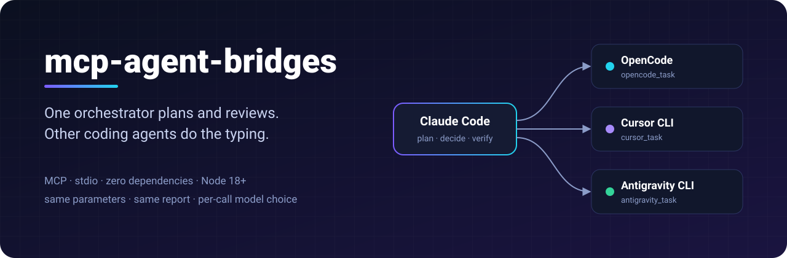
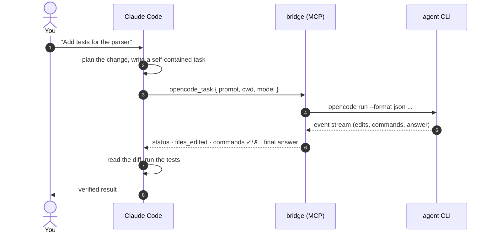
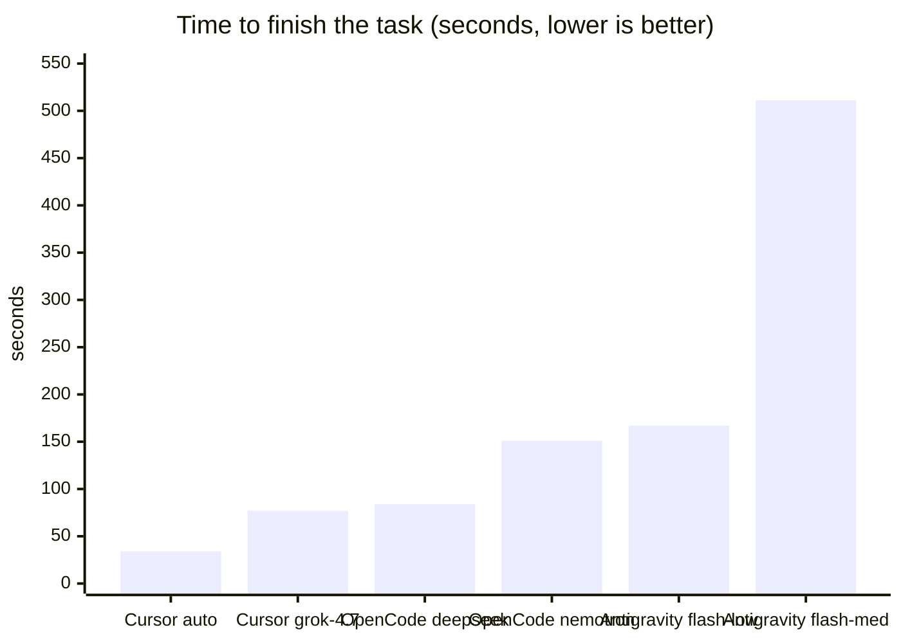

<p align="center">
  
</p>

<p align="center">
  <b>🇬🇧 English</b> &nbsp;|&nbsp; <a href="README.es.md">🇪🇸 Español</a>
</p>

<p align="center">
  <a href="https://github.com/ddzendreros/mcp-agent-bridges/actions/workflows/ci.yml"></a>
  <a href="LICENSE"></a>
  
  
  
  
</p>

<p align="center">
  <b><a href="#-quick-start">Quick start</a></b> ·
  <b><a href="#-benchmark">Benchmark</a></b> ·
  <b><a href="#-one-interface">Interface</a></b> ·
  <b><a href="docs/configuration.md">Configuration</a></b> ·
  <b><a href="#%EF%B8%8F-limitations">Limitations</a></b>
</p>

---

**mcp-agent-bridges** is a set of three small MCP servers that let **Claude Code** (or any MCP client) hand coding work to **OpenCode**, **Cursor CLI** and **Antigravity CLI**, and get back a short, uniform report it can verify.

The orchestrator keeps the expensive part: understanding the codebase, deciding and reviewing. The delegates do the mechanical part (the code, the tests, the boilerplate), often with cheaper or free models.

## ✨ Why

<table>
<tr>
<td width="33%" valign="top">

### 🔌 One interface
`prompt`, `cwd`, `model`, `fallback_models`, `session_id` and `timeout_s` on every bridge, and the same report back. Switch delegates without relearning flags.

</td>
<td width="33%" valign="top">

### 🧾 Reports you can check
Files edited, every command with ✓ / ✗ and its exit code, tokens and cost when available. The raw event stream goes to a local log you can turn off.

</td>
<td width="33%" valign="top">

### 🛡️ Clear permissions
Antigravity only runs commands you allow-list **exactly**, for that task only. OpenCode and Cursor auto-approve by default (headless they cannot edit otherwise), so point them at a repo under version control. A timeout or cancellation stops the agent **and everything it started**.

</td>
</tr>
<tr>
<td valign="top">

### 🔁 Model per call
Choose the model on every call and give an ordered list of fallbacks: on error (OpenCode), when a model is not on your plan (Cursor), or on usage/capacity limits (Antigravity).

</td>
<td valign="top">

### 🪟 Works on Windows
Fixes for issues found in daily use: multi-line prompts cut by `cmd.exe`, `cursor-agent` failing with *"Can't find Bash"*, OpenCode resolving paths in the wrong folder.

</td>
<td valign="top">

### 📦 Zero dependencies
Each bridge is a single readable `server.mjs`. Run it with `npx` straight from GitHub, or with `node` from a clone.

</td>
</tr>
</table>

## 🧭 How a delegation works



## 🚀 Quick start

**1. Install the agents you want** and log in to each one: [OpenCode](https://opencode.ai), [Cursor CLI](https://cursor.com/cli), Antigravity CLI. You also need **Node.js 18+**.

**2. Register the bridges** with Claude Code:

```bash
claude mcp add opencode    --scope user -- npx -y github:ddzendreros/mcp-agent-bridges opencode
claude mcp add cursor      --scope user -- npx -y github:ddzendreros/mcp-agent-bridges cursor
claude mcp add antigravity --scope user -- npx -y github:ddzendreros/mcp-agent-bridges antigravity
```

**3. Restart Claude Code and delegate:**

> *Use opencode_task with model opencode/deepseek-v4.1-flash-free to add unit tests for `src/parser.ts` and run them. Then review the diff yourself.*

<details>
<summary><b>Other ways to install</b> (clone, manual config, other MCP clients)</summary>

```bash
git clone https://github.com/ddzendreros/mcp-agent-bridges.git
claude mcp add opencode --scope user -- node /path/to/mcp-agent-bridges/packages/opencode-bridge/server.mjs
```

Or edit `~/.claude.json` by hand using [`examples/claude.json.example`](examples/claude.json.example). Any MCP client that speaks stdio can use the same entries. All environment variables are in [docs/configuration.md](docs/configuration.md).
</details>

<details>
<summary><b>Adding Codex</b> (official OpenAI server, not part of this repo)</summary>

Codex already ships its own MCP server. This repo does not wrap or modify it; it only appears in the benchmark as a reference point.

```bash
claude mcp add codex --scope user -- codex mcp-server
```

Pass `model` on every call (the server ignores `-c model=...`), and use `sandbox: "workspace-write"` with `approval-policy: "never"` for unattended edits.
</details>

## 📊 Benchmark

Same task and prompt for everyone, two models per tool, scored by a **hidden judge** with 23 checks that the agents never saw. The task: fix 9 planted bugs to match a spec, implement a missing function, write and run at least 6 tests, and leave two protected files untouched. The untouched project scores 8/23.

| Tool | Model | Time | Ran its own tests | Hidden judge |
|:--|:--|--:|:--:|:--:|
| Codex¹ | gpt-5.6-sol | n/a | ✅ | **23/23** |
| Codex¹ | gpt-5.6-luna | n/a | ✅ | **23/23** |
| OpenCode | deepseek-v4.1-flash-free | 84 s | ✅ | **23/23** |
| OpenCode | nemotron-3.5-lightning-free | 151 s | ✅ | **23/23** |
| Cursor | auto | **34 s** | ✅ | **23/23** |
| Cursor | grok-4.7-medium | 77 s | ✅ | **23/23** |
| Antigravity | gemini-3.8-flash-medium | 511 s | ✅² | **23/23** |
| Antigravity | gemini-3.8-flash-low | 167 s | ✅² | **23/23** |



<sub>¹ Official `codex mcp-server`, which does not report timing. ² With the test command passed in `allow_commands`. One run per configuration on a Windows laptop, 2026-11-14, so times are indicative. Details and a release check of this exact code: [benchmark/RESULTS.md](benchmark/RESULTS.md). Run it yourself with [benchmark/](benchmark/).</sub>

### What the test does and does not show

Every configuration solved the task, so this benchmark **does not rank the tools on quality**: the task is too easy to separate them, and one run per configuration is not enough for statistics. What it does show is speed, cost and how much each report helps the orchestrator verify the work. From that, and from day-to-day use:

| | Fits | Seen here |
|:--|:--|:--|
| 💸 **OpenCode** | volume and mechanical work | $0 with free models, the most detailed report, automatic model fallback |
| ⚡ **Cursor** | quick tasks | fastest with `auto`; the Free plan runs out of usage quickly |
| 🧯 **Antigravity** | backup | correct but slow, and bound by usage quotas |
| **Codex** (not part of this repo) | follow-ups in the same thread | short reports, but no timing, files or commands in its MCP output |

A harder task with several runs per configuration would be needed to compare quality; contributions welcome.

## 🔌 One interface

| | `opencode_task` | `cursor_task` | `antigravity_task` |
|:--|:--:|:--:|:--:|
| `prompt` · `cwd` · `model` · `timeout_s` | ✅ | ✅ | ✅ |
| `session_id` (follow-ups) | ✅ | ✅ | ✅ |
| `fallback_models` triggers on | error | model not on plan | usage / capacity limit |
| read-only mode | `agent: "plan"` | `mode: "plan"` / `"ask"` | `mode: "plan"` |
| `allow_commands` · `max_recoveries` | — | — | ✅ |
| list models | — | `cursor_models` | `antigravity_models` |

Every call returns the same kind of report:

```text
status: ok (exit 0, 57s)
session_id: 3f2a9c1e-5b7d-4e8a-9c0f-1d2e3f4a5b6c
model: Auto
attempts: claude-opus-5-5-high: not available for this account → auto: ok
files_edited: /work/inventario.py, /work/tests/test_nuevo.py
tools: read×4, glob×1, edit×2, shell×1
commands:
  ✓ python -m unittest discover -s tests -t . (exit 0 → OK)
log: ~/.mcp-agent-bridges/logs/cursor/2026-11-14T16-43-47-988Z_3f2a9c1e.jsonl
--- final answer ---
Fixed normalization, validation and de-duplication, implemented reabastecer,
added 6 tests. python -m unittest discover -s tests -t . → 7 tests OK.
```

<sub>Trimmed; the agent's answer is translated from Spanish.</sub> Full reference: [docs/interface.md](docs/interface.md).

## ⚠️ Limitations

Honest notes from daily use:

| | |
|:--|:--|
| 🐢 **Antigravity is slow and quota-bound** | It was the slowest in every run (up to ~8.5 min on a small task), and its models have per-account usage limits. When a limit is hit, or the server answers that it has no capacity, the bridge reports it. It only switches to other models of the same account if you set `fallback_models`. |
| 🔒 **Antigravity runs no commands by default** | In `accept-edits` mode every command is denied. Only exact strings in `allow_commands` run (no wildcards). Pass the exact test command if you want it to check its own work. |
| 🎟️ **Cursor Free plan** | It lists many models, but only `auto` and the Grok models actually run. Requests for other models fall back to `auto`, and the report says so. |
| 🪟 **Cursor through `cmd.exe`** | On Windows the bridge starts Cursor's own `node.exe` directly so prompts arrive intact. If it cannot find that install (for example `CURSOR_AGENT_BIN` points to a launcher outside the install folder), the prompt goes through `cmd.exe`: line breaks are replaced by spaces (the report says so) and `%NAME%` is expanded. |
| 🧾 **The report is a summary** | It is parsed from each CLI's event stream, whose format can change between versions. Always check the diff and run the tests. |
| ⏱️ **No real parallelism** | Claude Code tends to run calls to different MCP servers one after another. |
| 🪟 **Windows-first testing** | CI runs on Linux, macOS and Windows, but the end-to-end runs with the real CLIs were done on Windows 11. |

> [!IMPORTANT]
> This project does not include, and will not accept, anything that rotates accounts or gets around a provider's plan limits or terms of use.

## 🔍 Prior art

Other projects wrap one of these CLIs as an MCP server and are worth a look: [claude-opencode-mcp](https://github.com/putuandy/claude-opencode-mcp), [opencode-mcp](https://github.com/AlaeddineMessadi/opencode-mcp), [cursor-agent-mcp](https://github.com/sailay1996/cursor-agent-mcp), [cursormcp](https://github.com/sitien173/cursormcp), [gemini-mcp-tool](https://github.com/jamubc/gemini-mcp-tool), [Claude-Code-Antigravity-CLI-MCP-Server](https://github.com/SinanTufekci/Claude-Code-Antigravity-CLI-MCP-Server) and [all-agents-mcp](https://github.com/dokkabei97/all-agents-mcp).

What this repo focuses on:
- the **same parameters and report** across three different CLIs, designed for an orchestrator that verifies results;
- **per-call model choice with fallbacks**, and **exact-command allow-listing** for Antigravity;
- a **reproducible benchmark** with a hidden judge.

## 🗂️ Repository layout

```text
packages/
├── opencode-bridge/server.mjs      MCP server for OpenCode
├── cursor-bridge/server.mjs        MCP server for Cursor CLI
└── antigravity-bridge/server.mjs   MCP server for Antigravity CLI
bin/cli.mjs                         npx entry point: <opencode|cursor|antigravity>
benchmark/                          task, hidden judge, prompt and results
docs/                               configuration and interface reference
examples/claude.json.example        ready-made MCP config
test/                               tests and event-stream fixtures (no real CLI needed)
```

## 🛠️ Development

```bash
npm test
```

No real agent CLI is needed. The tests cover the MCP handshake, schemas and error handling of each bridge; the event-stream parsers, against fixtures with each CLI's structure; timeouts and cancellation stopping the whole process tree; multi-line prompts reaching Cursor; and that the plumbing shared by the three files stays identical.

Each bridge is one self-contained file on purpose. The process and MCP code they share sits between `// <shared>` markers and must be the same in all three; `test/shared.test.mjs` checks it.

Issues and pull requests are welcome; see [CONTRIBUTING.md](CONTRIBUTING.md). Please report security problems privately, as described in [SECURITY.md](SECURITY.md).

## 📄 License

[MIT](LICENSE) © Diego Zendreros

<sub>OpenCode, Cursor, Antigravity, Codex and Claude are trademarks of their respective owners. This project is not affiliated with or endorsed by any of them.</sub>
