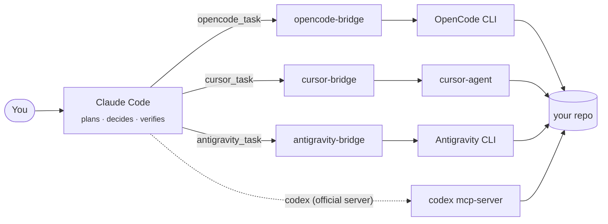

<div align="center">

# mcp-agent-bridges

**Let Claude Code plan and review while OpenCode, Cursor and Antigravity do the typing.**

Three zero-dependency MCP servers that put other coding agents' CLIs behind one consistent tool interface, so an orchestrating agent can delegate work, switch models per call and verify what comes back.

[](https://github.com/ddzendreros/mcp-agent-bridges/actions/workflows/ci.yml)
[](LICENSE)


[Quick start](#quick-start) · [Results](#benchmark) · [Interface](#one-interface-for-every-agent) · [Configuration](docs/configuration.md) · [Limitations](#limitations) · [Español](README.es.md)

</div>

---

## The problem

Claude Code is very good at understanding a codebase, deciding what to do and checking the result. Spending its context and tokens on typing boilerplate, repetitive refactors or test files is wasteful, especially when you already pay for (or have free access to) other coding agents.

Those agents all have headless CLIs, but each speaks its own flags, output format and permission model, and a few have platform quirks that break them when run from another program. **mcp-agent-bridges** wraps each CLI in a small MCP server so the orchestrator sees the same tool shape and the same compact report every time.



## Highlights

- **One interface** — `prompt`, `cwd`, `model`, `fallback_models`, `session_id`, `timeout_s` on every bridge; the same `status / files_edited / commands / final answer` report back.
- **Pick the model per call** — no need to edit each tool's config to switch models.
- **Compact reports, full logs** — the orchestrator gets a short summary (with ✓/✗ for every command the agent ran); the raw event stream goes to a local log file you can turn off.
- **Safe defaults** — Antigravity runs in `accept-edits` and only executes commands you allow-list **exactly**, for that task only. Nothing is written to the tools' own settings.
- **Windows-ready** — fixes we hit in practice: multi-line prompts cut by `cmd.exe`, `cursor-agent` failing with *"Can't find Bash"*, OpenCode resolving paths against the wrong folder.
- **Zero dependencies** — each bridge is a single `server.mjs` file you can read in a few minutes.

## Quick start

**1.** Install and log in to the CLIs you want to use: [OpenCode](https://opencode.ai), [Cursor CLI](https://cursor.com/cli), Antigravity CLI. You need Node.js 18+.

**2.** Register the bridges with Claude Code:

```bash
claude mcp add opencode    --scope user -- npx -y github:ddzendreros/mcp-agent-bridges opencode
claude mcp add cursor      --scope user -- npx -y github:ddzendreros/mcp-agent-bridges cursor
claude mcp add antigravity --scope user -- npx -y github:ddzendreros/mcp-agent-bridges antigravity
```

**3.** Restart Claude Code and ask it to delegate:

> *Use opencode_task with model opencode/deepseek-v4.1-flash-free to add unit tests for `src/parser.ts`, run them, and then review the diff.*

Prefer a local clone, or using another MCP client? See [docs/configuration.md](docs/configuration.md) for `node`-path setup, a ready-made [`.claude.json` example](examples/claude.json.example) and every environment variable.

<details>
<summary><b>Adding Codex too</b> (official server, not part of this repo)</summary>

Codex already ships an MCP server, made by OpenAI. This repo does not wrap or modify it; it is only included in the benchmark as a reference point.

```bash
claude mcp add codex --scope user -- codex mcp-server
```

Pass `model` on every call (the server ignores `-c model=...`), and use `sandbox: "workspace-write"` with `approval-policy: "never"` for unattended edits.
</details>

## Benchmark

Same task, same prompt, two models per tool, scored by a **hidden judge** the agents never saw: fix 9 planted bugs to match a spec, implement a missing function, write and run at least 6 tests, and leave two protected files untouched. The untouched project scores 8/23.

| Tool | Model | Time | Ran its own tests | Hidden judge |
|---|---|---:|:---:|:---:|
| Codex¹ | gpt-5.6-sol | n/a | ✓ | **23/23** |
| Codex¹ | gpt-5.6-luna | n/a | ✓ | **23/23** |
| OpenCode | deepseek-v4.1-flash-free | 84 s | ✓ | **23/23** |
| OpenCode | nemotron-3.5-lightning-free | 151 s | ✓ | **23/23** |
| Cursor | auto | **34 s** | ✓ | **23/23** |
| Cursor | grok-4.7-medium | 77 s | ✓ | **23/23** |
| Antigravity | gemini-3.8-flash-medium | 511 s | ✓² | **23/23** |
| Antigravity | gemini-3.8-flash-low | 167 s | ✓² | **23/23** |

<sub>¹ Official `codex mcp-server`, which does not report timing. ² With the test command passed in `allow_commands`. One run per configuration on a Windows laptop, 2026-11-14: times are indicative. Reproduce it with [`benchmark/`](benchmark/).</sub>

**Takeaways.** All of them solved it; the differences are speed, cost and how easy the result is to verify.

| Use | For | Because |
|---|---|---|
| Codex | important or tricky changes | strongest models, honest short reports, keeps the conversation for follow-ups |
| OpenCode | volume and mechanical work | $0 with free models, the most detailed report, automatic model fallback |
| Cursor | quick tasks | fastest in the test with `auto` |
| Antigravity | backup | correct but slow, and limited by usage quotas |

## One interface for every agent

| | `opencode_task` | `cursor_task` | `antigravity_task` |
|---|:---:|:---:|:---:|
| `prompt`, `cwd`, `model`, `timeout_s` | ✓ | ✓ | ✓ |
| `session_id` (follow-ups) | ✓ | ✓ | ✓ |
| `fallback_models` | on error | on model unavailable | on usage/capacity limit |
| read-only mode | `agent: "plan"` | `mode: "plan"` / `"ask"` | `mode: "plan"` |
| `allow_commands`, `max_recoveries` | — | — | ✓ |
| list models | — | `cursor_models` | `antigravity_models` |

A typical report (trimmed; the agent's answer translated from Spanish):

```text
status: ok (exit 0, 34s)
session_id: 3f2a9c1e-5b7d-4e8a-9c0f-1d2e3f4a5b6c
model: Auto
files_edited: /work/inventario.py, /work/tests/test_nuevo.py
tools: read×4, glob×1, edit×2, shell×1
commands:
  ✓ python -m unittest discover -s tests -t . (exit 0 → OK)
log: ~/.mcp-agent-bridges/logs/cursor/2026-11-14T15-53-39-535Z_3f2a9c1e.jsonl
--- final answer ---
Fixed parse_linea (strip, upper-case SKU, comma decimals, validation) ... 9 tests OK.
```

Full reference: [docs/interface.md](docs/interface.md).

## Teach Claude when to delegate

[`skills/delegate-coding-tasks`](skills/delegate-coding-tasks/SKILL.md) is an optional Claude Code skill that tells the orchestrator what to delegate, which bridge to pick, how to write a self-contained task and how to verify the result. Copy the folder into `~/.claude/skills/` to use it.

## Limitations

Honest notes from using these daily:

- **Antigravity is slow and quota-bound.** It was the slowest in every run (up to ~8.5 min on a small task), and its models have usage limits per account. When a limit is hit (or the server answers that it has no capacity) the bridge reports it, and it only switches to other models of the same account if you configure `fallback_models`.
- **Antigravity cannot run commands by default.** In `accept-edits` mode any command is denied; only exact strings in `allow_commands` are allowed (no wildcards). The bridge resumes the conversation after a blocked command, but give it the exact verification command if you want it to test its work.
- **Cursor on the Free plan** lists many models, but only `auto` and Grok models actually run. Requests for other models fall back to `auto` and the report says so.
- **The report is a summary.** It is parsed from each CLI's event stream, whose format can change between CLI versions. Always check the diff and run the tests yourself.
- **No real parallelism.** Claude Code tends to run calls to different MCP servers one after another.
- **Windows-first testing.** The bridges are built to be cross-platform and CI runs on Linux, macOS and Windows, but end-to-end runs with the real CLIs were done on Windows 11.

This project does not include, and will not accept, anything to rotate accounts or get around a provider's plan limits or terms of use.

## Prior art

Several projects wrap one of these CLIs as an MCP server, for example [claude-opencode-mcp](https://github.com/putuandy/claude-opencode-mcp), [opencode-mcp](https://github.com/AlaeddineMessadi/opencode-mcp), [cursor-agent-mcp](https://github.com/sailay1996/cursor-agent-mcp), [cursormcp](https://github.com/sitien173/cursormcp), [gemini-mcp-tool](https://github.com/jamubc/gemini-mcp-tool), [Claude-Code-Antigravity-CLI-MCP-Server](https://github.com/SinanTufekci/Claude-Code-Antigravity-CLI-MCP-Server) and [all-agents-mcp](https://github.com/dokkabei97/all-agents-mcp). They are worth a look. This repo's focus is narrower:

- the **same parameters and report** across three different CLIs, built for an orchestrator that verifies results;
- **per-call model choice with fallbacks** and **exact-command allow-listing** for Antigravity;
- a **reproducible benchmark** with a hidden judge.

## Repository layout

```text
packages/
  opencode-bridge/server.mjs      MCP server for OpenCode
  cursor-bridge/server.mjs        MCP server for Cursor CLI
  antigravity-bridge/server.mjs   MCP server for Antigravity CLI
bin/cli.mjs                       `npx ... <opencode|cursor|antigravity>` entry point
benchmark/                        task, hidden judge, prompt and results
skills/delegate-coding-tasks/     optional Claude Code skill
docs/                             configuration and interface reference
examples/claude.json.example      ready-made MCP config
test/                             smoke tests (no real CLI needed)
```

## Development

```bash
npm test     # starts each bridge over stdio and checks the handshake, schemas and error handling
```

Issues and pull requests are welcome; see [CONTRIBUTING.md](CONTRIBUTING.md). Please report security problems privately, as described in [SECURITY.md](SECURITY.md).

## License

[MIT](LICENSE) © Diego Zendreros. OpenCode, Cursor, Antigravity, Codex and Claude are trademarks of their respective owners; this project is not affiliated with or endorsed by any of them.
